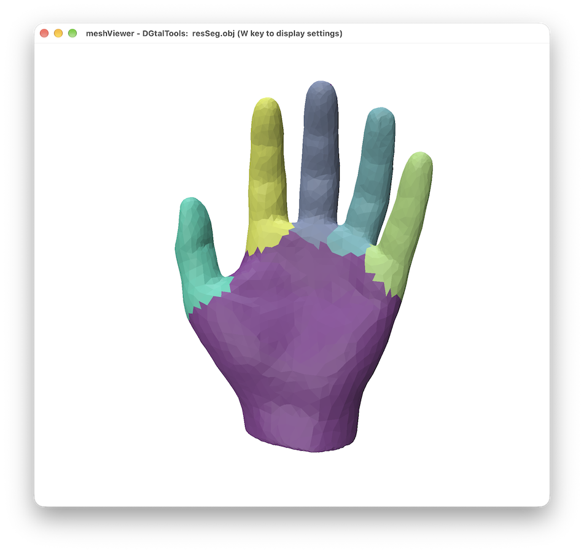
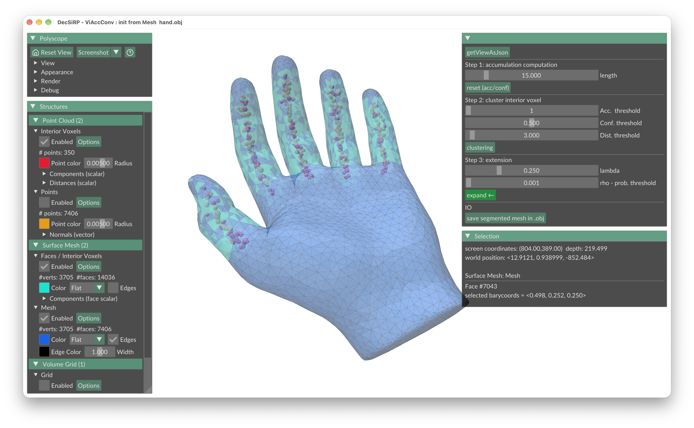

# DecSiRP

**A Voting Scheme for Decomposing Surfaces into Round Primitives**

Source code accompanying the paper by Xun Gong, Tristan Roussillon, and Bertrand Kerautret (*submitted*).

## Dependencies

- CMake >= 3.6
- [DGtal](https://github.com/DGtal-team/DGtal) >= 2.1
- [Polyscope](https://github.com/nmwsharp/polyscope) >= 2.4.0 *(optional, for 3D visualization through DGtal's PolyscopeViewer)*


## Build
 ```bash
git clone https://github.com/Seangongx/DecSiRP.git
cd DecSiRP
cmake -S . -B build
cmake --build build
```
If DGtal is installed locally and CMake cannot find it automatically, specify its build directory:

```bash
cmake -S . -B build -DDGtal_DIR=/path/to/DGtal/build
cmake --build build
```

## Typical use
### Without interface  
```bash
./viz -m ../Samples/hand.obj  -l 15 -a 1 -c 0.5 -d 3 --rho 0.001 --lambda 0.75  --export-segmentation resSeg.obj
```
You will obtain the resulting `reset.obj` file, that you can display from the meshViewer of [DGTalTools](https://github.com/DGtal-team/DGtalTools) project.
```bash
meshViewer  resSeg.obj
```
you will obtain:
<p align="center">
  
</p>

### With polyscope display
```bash
     ./viz -m ../Samples/hand.obj 
```
The interface allow to interact with the main three steps of the algorithm: 
<p align="center">
  
</p>


## Citation

If you use this code in your research, please cite the associated paper once it is published.
