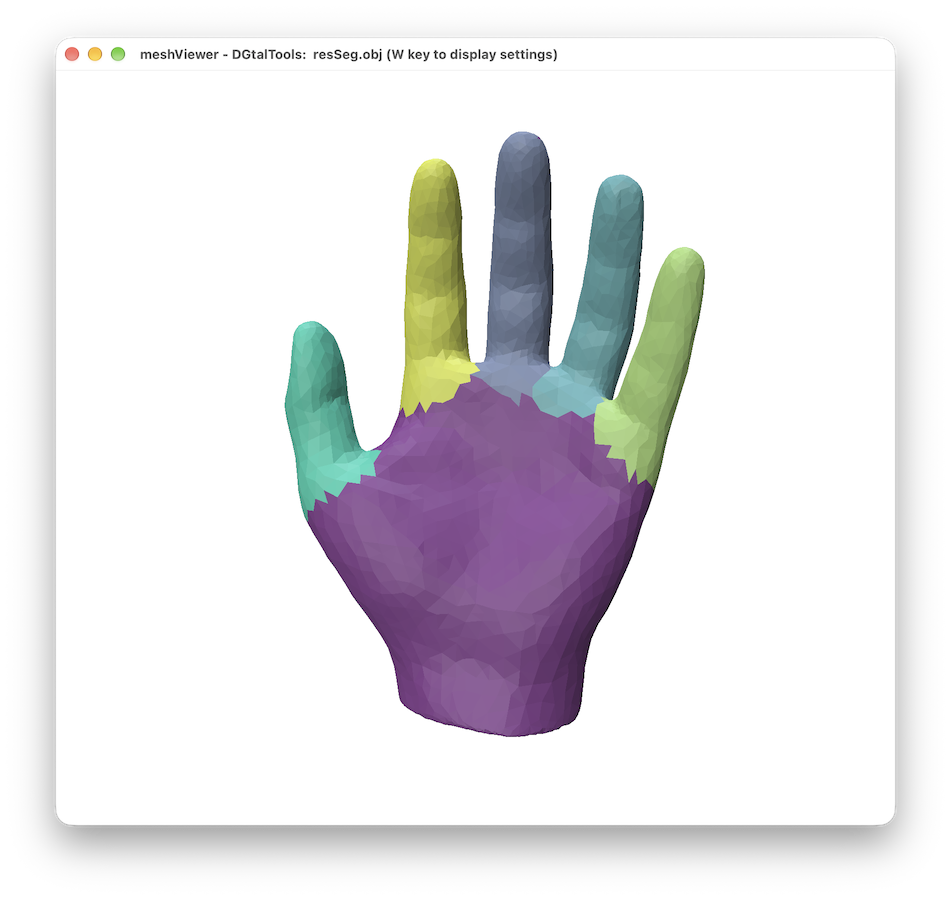
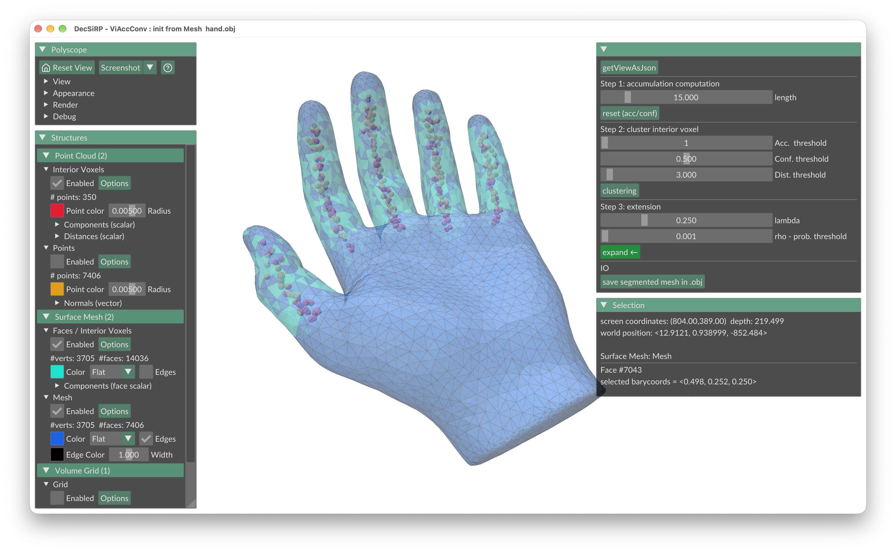

# DecSiRP

**A Voting Scheme for Decomposing Surfaces into Round Primitives**

Source code accompanying the paper by Xun Gong, Tristan Roussillon, and Bertrand Kerautret (*submitted*).

[](https://github.com/Seangongx/DecSiRP/actions/workflows/ci.yml)

## Dependencies

- CMake >= 3.16
- [DGtal](https://github.com/DGtal-team/DGtal) >= 2.1
- [Polyscope](https://github.com/nmwsharp/polyscope) >= 2.4.0 *(optional, for the interactive viewer through DGtal's PolyscopeViewer; without it, only the batch mode `--export-segmentation` is available)*


## Build
 ```bash
git clone https://github.com/Seangongx/DecSiRP.git
cd DecSiRP
cmake -S . -B build
cmake --build build
```
If DGtal is installed locally and CMake cannot find it automatically, specify its build directory:

```bash
cmake -S . -B build -DDGtal_DIR=/path/to/DGtal/build
cmake --build build
```

## Typical use

The input is either a polygonal mesh (`-m`) or a 3D binary image (`-i`), whose digital surface is processed.
The parameters follow the notations of the paper:

| Option | Paper | Meaning |
|---|---|---|
| `-g` | h | grid step (mesh only) |
| `-t` | | radius of the neighborhood used for normal estimation (image only) |
| `-l` | ℓ | segment length |
| `-a` | a | accumulation threshold |
| `-c` | c | confidence threshold |
| `-d` | d | reachable distance threshold |
| `--lambda` | λ | inverse of the diffusion time of the label extension |
| `--rho` | ρ | threshold of the label extension |

### Without interface
```bash
./decSiRP -m ../Samples/hand.obj  -l 15 -a 1 -c 0.5 -d 3 --rho 0.001 --lambda 0.75  --export-segmentation resSeg.obj
```
You will obtain the resulting `resSeg.obj` file, that you can display with the meshViewer of the [DGtalTools](https://github.com/DGtal-team/DGtalTools) project.
```bash
meshViewer  resSeg.obj
```
you will obtain:
<p align="center">
  
</p>

### With polyscope display
```bash
./decSiRP -m ../Samples/hand.obj -l 15 -a 1 -c 0.5 -d 3
```
The interface allows to interact with the three steps of the algorithm:
<p align="center">
  
</p>

## Code organization

| File | Content |
|---|---|
| `src/decSiRP.cpp` | command-line tool |
| `src/core/InputSurface` | input data: points x<sub>i</sub>, inward normals n<sub>i</sub> and facets f<sub>i</sub>, from a mesh or a digital surface (Sect. 2.1) |
| `src/core/VotingScheme` | segments S<sub>i</sub>, accumulation A and confidence C (Sect. 2.1) |
| `src/core/InteriorVoxelClustering` | reachable distance D, candidate and interior voxels, clustering (Sect. 2.2), mapping back to the surface (Sect. 2.3) |
| `src/core/LabelExtension` | dual graph, Laplacian and label extension (Sect. 2.3) |
| `src/core/Decomposition` | full pipeline and export of the segmented mesh |
| `src/viewer/Viewer` | interactive Polyscope viewer |

## Differences with the paper

The implementation slightly differs from the description of the paper on the following points:

- **Threshold on the reachable distance.** The paper defines candidate voxels with D(v) ≥ d, whereas the code uses a strict inequality D(v) > d.
- **Label extension.** In the paper, the labeling function σ(x<sub>i</sub>) (argmax of the diffused values x(l)<sub>i</sub>, provided it is at least ρ) is applied to every surface point. In the code, it is only applied to unlabeled points: points labeled after the mapping back to the surface (seeds) keep their label, whatever the diffused values.

## Changes since the experiments of the paper

The figures and tables of the paper were produced with an earlier version of the code. The following changes were made afterwards, so that the results may slightly differ from those of the paper:

- **Mapping back to the surface.** As described in the paper, the label of a point x<sub>i</sub> is now the label of the interior voxel v ∈ S<sub>i</sub> closest to x<sub>i</sub>, i.e. the first interior voxel met along the segment. The earlier version instead took the interior voxel v ∈ S<sub>i</sub> of smallest reachable distance D(v). Both rules only differ when a segment crosses several clusters; on the samples of this repository, this changes less than 0.2% of the seeds and less than 0.1% of the final labels.
- **Segment rasterization.** Voxels are unit cubes centered at integer points: this is the convention used to embed digital surfaces and to compute the reachable distance D(v). The earlier version rasterized segments as if voxel v were the cube [v, v+1)<sup>3</sup>, i.e. with a shift of half a voxel along each axis. With the corrected rasterization, and the parameters of Table 1, the number of clusters is unchanged in all experiments of the paper. The final labels of about 3% of the facets change for the hand and horse models, mainly along the boundaries between primitives, and the decompositions of the half-ball, can and torus knot are unchanged.
- **Default values.** The default values of the options are now those of the online demo: ℓ = 15, a = 1, c = 0.5, d = 1, λ = 0.5, ρ = 0.001.

## Citation

If you use this code in your research, please cite the associated paper once it is published.
